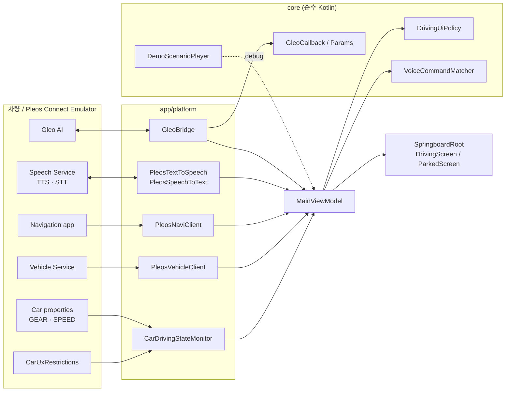

# 프로젝트 구조

## 1. 모듈

```
springboard/
├── core/   순수 Kotlin(JVM). 안드로이드·Pleos SDK 의존 없음 → ./gradlew :core:test 로 바로 검증
│   └── com.springboard.core
│       ├── driving/   Gear, UxRestrictions(플래그), DrivingState, DrivingUiPolicy(화면 허용 범위)
│       ├── vehicle/   VehicleReading(읽기 결과: 값/실패/시간초과/서비스없음), VehicleSnapshot
│       ├── demo/      DemoScenario(s), DemoScenarioPlayer(Flow) — GPU 없이 주차→주행→정차 흉내
│       ├── voice/     VoiceCommandMatcher — STT 문장 → 예/아니오/취소/키워드 명령
│       └── gleo/      GleoCallback, GleoActionParams, GleoSchemaRules — Gleo Interface JSON
└── app/    Pleos Connect 안드로이드 앱 (Kotlin + Jetpack Compose)
    └── com.springboard.app
        ├── SpringboardApplication / AppContainer   앱 수명 객체(차량 연결·SDK 세션) 수동 주입
        ├── MainActivity                             Compose 진입점, CCP Back(moveTaskToBack), Gleo Intent
        ├── MainViewModel / MainUiState             화면 상태 만들기 (단방향: ViewModel → 화면)
        ├── platform/                                바깥 세상과 닿는 곳 (여기만 SDK·Car API 를 안다)
        │   ├── car/CarDrivingStateMonitor          CarUxRestrictions + GEAR_SELECTION + PERF_VEHICLE_SPEED
        │   ├── vehicle/PleosVehicleClient          Vehicle SDK (코루틴, 시간 제한)
        │   ├── navi/PleosNaviClient                NaviHelper (콜백 → 이벤트)
        │   ├── speech/PleosTextToSpeech·SpeechToText  온디바이스 음성
        │   └── gleo/GleoBridge·GleoActionReceiver   Gleo Action 받기·Callback 보내기
        └── ui/
            ├── SpringboardRoot                      주행 규제면 DrivingScreen, 아니면 ParkedScreen
            ├── driving/DrivingScreen                주행 중: 정보 1~2개, 큰 버튼, 음성
            ├── parked/ParkedScreen                  주차 중: 지금은 SDK 점검 홈 → 실제 홈으로 교체
            ├── components/                          CarButton(76dp·95% 눌림), SectionCard, InfoRow…
            └── theme/                               어두운 고대비 테마, 큰 글자, CarDimens
```

규칙
- **SDK·Car API는 `platform/` 밖으로 새지 않는다.** 화면과 ViewModel은 `core`의 타입(DrivingState, VehicleReading…)만 본다.
- **판단 로직은 `core`에** 둔다 (예: "배터리 30% 이하이고 주행 중이면 안내"). 테스트가 쉽고 에뮬레이터 없이 돈다.
- 화면은 상태를 그리기만 한다. 버튼 이벤트는 `MainActions`로 ViewModel에 전달.

## 2. 데이터 흐름



## 3. 주행/주차 화면 전환 규칙

1. 실제 차량(에뮬레이터)이 **DO 필요**(`isRequiresDistractionOptimization = true`)를 알리면 → 무조건 `DrivingScreen` (안전 우선)
2. 아니고 데모 시나리오가 재생 중이면 → 데모 상태 (debug 빌드 전용)
3. 아니면 → 실제 상태 (차량이 아니면 `UNAVAILABLE` = 주차 화면)

`DrivingUiPolicy`가 플래그를 "키보드 허용? 목록 몇 개까지? 글자 몇 자까지? 음성 우선?"으로 바꿔 준다. 화면은 플래그를 직접 해석하지 않는다.

## 4. 새 기능 추가 순서 (예: "배터리 낮으면 충전소 경유 제안")

1. **core에 로직 + 테스트**: `core/.../charging/ChargeAdvisor.kt` — 입력(SOC, 주행 상태, 목적지 남은 거리) → 출력(제안 여부, 문장). `ChargeAdvisorTest`로 경계값 테스트.
2. **platform에 데이터 연결**: `PleosVehicleClient`에 `readEvBatteryPercent()`(또는 `registerEvBatteryStateOfCharge` 구독) 추가, 매니페스트에 `CAR_ENERGY` 권한 추가.
3. **ViewModel에서 연결**: 값 → `ChargeAdvisor` → 상태/음성.
4. **화면**: 주행 화면에는 한 문장 + 버튼 1개, 주차 화면에는 상세.
5. **데모 시나리오**: `DemoScenarios`에 SOC가 떨어지는 장면을 추가해 GPU 없이도 확인.
6. **에뮬레이터 확인**: Virtual Console Energy > Battery SOC를 30%로 → 동작 확인. 시연 대본에 추가.

## 5. 이름 바꾸기 (앱 이름·패키지가 정해지면)

| 바꿀 것 | 위치 |
|---|---|
| 앱 표시 이름 | `app/src/main/res/values/strings.xml` `app_name` |
| 제출 APK 이름 | `gradle.properties` `submission.teamName`, `submission.appName` |
| applicationId | `app/build.gradle.kts` `applicationId` (스토어·Gleo 스키마 `packageName`과 같게) |
| 코드 패키지(선택) | `namespace` + 폴더 `com/springboard/app` → Android Studio Refactor > Rename |
| Gleo 스키마 | `packageName`, `appDescription`, `invokeWord` |
| 아이콘 | `res/drawable/ic_launcher_foreground.xml`, `res/values/colors.xml` |

## 6. 일부러 하지 않은 것

- Hilt·Navigation·Room 등은 넣지 않았다. 아이디어가 정해지고 필요할 때 추가한다 ([open-source.md](../03-references/open-source.md) 4절).
- 문자열 리소스화·다국어는 하지 않았다(속도 우선). 출시 단계에서 `strings.xml`로 옮긴다.
- FusedLocation은 넣지 않았다. 위치는 NaviHelper로 먼저 해결한다.
